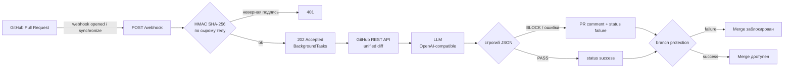

# 🛡️ Compliance Sentinel

[](#тесты)
[](#требования)
[](https://fastapi.tiangolo.com/)
[](#llm-провайдер)
[](https://github.com/Horda23/SecureMerge/actions/workflows/ci.yml)
[](#быстрый-старт)

> **SecureMerge** — репозиторий проекта; **Compliance Sentinel** — имя
> GitHub-бота. Для сдачи и демо см. [SUBMISSION.md](SUBMISSION.md).

AI-бот для GitHub, который перехватывает Pull Request, анализирует `git diff`
с помощью LLM и **блокирует слияние**, если находит критический риск:

- захардкоженные пароли, токены, ключи и строки подключения;
- утечку или небезопасную обработку персональных данных;
- зависимости с вирусными (copyleft) лицензиями, в первую очередь GPL/AGPL;
- опасные уязвимости: SQL/command injection, path traversal, SSRF,
  небезопасную десериализацию, отключённый TLS и т. п.

Бот работает по событиям `pull_request` (`opened` и `synchronize`), пишет
комментарий с причиной и выставляет commit status `failure`/`success`.
При включённом branch protection кнопка **Merge** блокируется на `failure`.

> **Принцип fail-closed:** если LLM или GitHub недоступны, diff слишком
> большой или модель вернула некорректный JSON, PR блокируется для ручной
> проверки. Compliance-бот не должен пропускать риск из-за сбоя зависимости.

## Демо

| Что | Где |
| --- | --- |
| Открытый PR, который бот заблокировал | [PR #3](https://github.com/Horda23/SecureMerge/pull/3) |
| Live-демо | ссылка **Website** в блоке About этого репозитория (обновляется автоматически) |
| Release для сдачи | [v1.0.3](https://github.com/Horda23/SecureMerge/releases/tag/v1.0.3) |
| Чек-лист жюри | [SUBMISSION.md](SUBMISSION.md) |

> в live-демо используется локальная Qwen2.5 3B через Ollama в Docker —
> без внешних API и биллинга. Проект также поддерживает любой
> OpenAI-совместимый endpoint.
>
> Live-демо обслуживается постоянным HTTP-туннелем `bore.pub` с локального
> ПК. Для production нужен HTTPS (Render или reverse-proxy); ссылка Website
> обновляется автоматически при смене порта.

## Как это работает



| Результат | Комментарий в PR | Commit status | Merge |
| --- | --- | --- | --- |
| `BLOCK` | да, с причиной | `failure` | заблокирован* |
| `PASS` | нет | `success` | доступен* |
| Сбой анализа | да, с пояснением | `failure` | заблокирован* |

\* При включённой обязательной проверке `Compliance Sentinel` в branch
protection и выключенном admin bypass.

## Требования

- Python 3.10+ — для локального запуска без Docker.
- Docker Desktop / Docker Engine с Compose — для контейнерного запуска.
- Публичный GitHub-репозиторий (branch protection на Free-плане доступен
  только для публичных репозиториев).
- GitHub PAT со scope `repo` или fine-grained правами на contents, pull
  requests и commit statuses.
- LLM: локальная Ollama или любой OpenAI-совместимый `/chat/completions`.

## Быстрый старт (Docker)

```bash
cp .env.example .env
# заполнить GITHUB_TOKEN, GITHUB_WEBHOOK_SECRET и LLM_API_KEY
docker compose up -d --build
curl http://127.0.0.1:8000/health
```

Для локальной модели один раз поднимите Ollama и загрузите модель:

```bash
docker run -d --name compliance-ollama --restart unless-stopped \
  -p 11434:11434 -v compliance_ollama:/root/.ollama ollama/ollama
docker exec compliance-ollama ollama pull qwen2.5:3b
```

В `.env` для приложения в Docker укажите:

```dotenv
LLM_API_KEY=ollama
LLM_API_URL=http://host.docker.internal:11434/v1
LLM_MODEL=qwen2.5:3b
LLM_TIMEOUT_SECONDS=300
LLM_MAX_RETRIES=1
```

`host.docker.internal` работает из контейнера. При запуске через `uvicorn`
на хосте используйте `LLM_API_URL=http://127.0.0.1:11434/v1`.

## Ручной локальный запуск

```bash
python -m venv .venv
source .venv/bin/activate        # Windows: .venv\Scripts\activate
pip install -r requirements.txt
uvicorn main:app --host 0.0.0.0 --port 8000
```

Или одной командой на Windows: `.\start.ps1`, на Linux/macOS: `./start.sh`.

## LLM-провайдер

Проект не привязан к конкретному поставщику: `ai_analyzer.py` отправляет
запросы на OpenAI-совместимый endpoint `/chat/completions` с JSON mode.

| Переменная | Обязательна | По умолчанию | Назначение |
| --- | --- | --- | --- |
| `LLM_API_KEY` | да | — | ключ провайдера; для локальной Ollama — `ollama` |
| `LLM_API_URL` | нет | `http://host.docker.internal:11434/v1` | базовый URL или полный `/chat/completions` |
| `LLM_MODEL` | нет | `qwen2.5:3b` | имя модели |
| `LLM_TIMEOUT_SECONDS` | нет | `300` | таймаут запроса |
| `LLM_MAX_RETRIES` | нет | `1` | повторы при `429`/`5xx`/сетевых ошибках |

Если провайдер не поддерживает `response_format=json_object`, бот всё равно
пытается извлечь JSON из ответа; при неудаче срабатывает fail-closed.

## Настройка `.env`

| Переменная | Обязательна | Назначение |
| --- | --- | --- |
| `GITHUB_TOKEN` | да | PAT для чтения PR, комментариев и статусов |
| `GITHUB_WEBHOOK_SECRET` | да | секрет вебхука, минимум 16 символов |
| `LLM_API_KEY` | да | ключ LLM-провайдера |
| `LLM_API_URL` | нет | endpoint провайдера |
| `LLM_MODEL` | нет | модель |
| `STATUS_CONTEXT` | нет | контекст проверки, по умолчанию `Compliance Sentinel` |
| `PUBLIC_BASE_URL` | нет | публичный URL для ссылки Details |
| `ALLOWED_REPOSITORIES` | нет | allow-list `owner/repo` через запятую |

`.env` исключён из Git; `.env.example` не содержит секретов.

## Настройка GitHub

1. Создайте вебхук в репозитории:
   - Payload URL: `https://<ваш-домен>/webhook`;
   - Content type: `application/json`;
   - Secret: то же значение, что `GITHUB_WEBHOOK_SECRET`;
   - Events: **Pull requests**.
2. Проверьте доставку через **Redeliver** — должен прийти `202`.
3. В **Settings → Branches → Branch protection** для `main`:
   - включите **Require status checks to pass before merging**;
   - добавьте проверку `Compliance Sentinel`;
   - желательно выключить **Allow administrators to bypass**.

Для публичного HTTPS-доступа при локальном запуске подойдёт любой
reverse-tunnel (например, `ssh -R 80:localhost:8000 nokey@localhost.run`).
URL нужно указать в webhook и, при желании, в `PUBLIC_BASE_URL`.

### Render

В репозитории есть `render.yaml` для Docker-деплоя. Render не видит локальную
Ollama, поэтому в Render Dashboard нужно задать `LLM_API_KEY`, `LLM_API_URL`
и `LLM_MODEL` внешнего OpenAI-совместимого провайдера.

## Демо-сценарий

В [PR #3](https://github.com/Horda23/SecureMerge/pull/3) добавлен файл с
вымышленным паролем. Ожидаемое поведение:

1. GitHub отправляет `pull_request/opened`.
2. Бот получает diff и отправляет его в локальную LLM.
3. В PR появляется комментарий с найденным риском (значение секрета
   маскируется).
4. Commit status становится `failure`, кнопка Merge блокируется.
5. После исправления и нового коммита приходит `synchronize`, бот проверяет
   заново и при `PASS` ставит `success`.

Пароль в демо вымышленный. Реальные секреты в репозиторий не добавлялись.

## Тесты

```bash
python -m pytest -q
python -m ruff check .
```

Покрыты: HMAC и размер тела, allow-list репозиториев, разбор diff и JSON,
fail-closed, ретраи, публикация комментария/статуса, маскирование секретов,
полный audit-flow с мок-сервером GitHub/LLM.

## Безопасность

- HMAC SHA-256 проверяется по сырому телу запроса; сравнение constant-time.
- Ограничение размера тела и diff; allow-list репозиториев.
- Валидация `owner/repo`, PR number и commit SHA перед API-запросами.
- HTML экранируется, `@`-упоминания и markdown-ссылки нейтрализуются.
- Значения известных форматов токенов и типичные секреты в кавычках/присваиваниях
  маскируются как `[REDACTED]`.
- Секреты не логируются; `.env` не попадает в Git/Docker image.
- LLM получает diff в маркерах, системный промпт требует игнорировать
  инструкции из diff.

## Ограничения MVP

- Анализируется только diff, без полного контекста репозитория.
- Локальная Qwen2.5 3B слабее облачных моделей и может ошибаться.
- Большой diff или обрезанный ответ LLM → fail-closed.
- `BackgroundTasks` не переживают рестарт процесса; нет очереди и
  дедупликации доставок.
- Нет CI-workflow и постоянного облачного хостинга в текущей поставке.
- Бот — дополнительный контур, а не замена SAST/secret scanning/ревью.

## Структура проекта

```text
main.py               FastAPI, /webhook, HMAC, фоновая оркестрация
ai_analyzer.py        запрос к OpenAI-совместимому LLM, JSON и fail-closed
github_api.py         GitHub REST: PR и diff
github_actions.py     комментарии и commit statuses
config.py             .env и валидация настроек
tests/                pytest-набор
Dockerfile            production-контейнер
docker-compose.yml    app + Ollama-подсказки
render.yaml           blueprint для Render
start.ps1 / start.sh  локальный запуск
```

## API

| Метод | Путь | Назначение |
| --- | --- | --- |
| `GET` | `/health` | liveness/readiness |
| `POST` | `/webhook` | приём GitHub webhook с HMAC |
| `GET` | `/docs` | Swagger UI |

## Лицензия

Проект создан для хакатона. Если нужна открытая лицензия для повторного
использования — добавьте `LICENSE` (например, MIT) после согласования с
автором.
